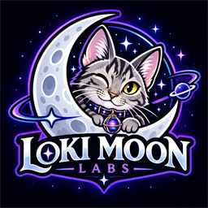

# Loki Moon Labs - DSP Mod Support

Report bugs and compatibility problems with Loki Moon Labs mods for **Dyson Sphere Program** here.

**[Report a bug](https://github.com/darklordcoz/LokiMoonLabs-DSP-Mod-Support/issues/new?template=bug_report.yml)** · **[Browse existing reports](https://github.com/darklordcoz/LokiMoonLabs-DSP-Mod-Support/issues)** · **[Download our mods](https://thunderstore.io/c/dyson-sphere-program/p/LokiMoonLabs/)**

## Reporting a problem

Search the existing reports first. If your problem has not been reported, open the bug-report form and select the affected mod. Include the mod version, game version, what happened, what you expected, and the steps that reproduce the problem. Mention other mods that may be involved.

Screenshots and relevant log excerpts help us investigate. In r2modman, use **Settings → Browse profile folder** to find `BepInEx/LogOutput.log`. Review logs and screenshots before attaching them and remove personal information you do not want to share. Reports and attachments in this repository are public. Do not upload save files unless a maintainer asks for one and you are comfortable sharing it publicly.

## Supported mods

| Mod | Thunderstore listing |
| --- | --- |
| Hand Crafted Trinkets | [Download](https://thunderstore.io/c/dyson-sphere-program/p/LokiMoonLabs/HandCraftedTrinkets/) |
| Logistics Architect | [Download](https://thunderstore.io/c/dyson-sphere-program/p/LokiMoonLabs/LogisticsArchitect/) |
| Logistics Capacities | [Download](https://thunderstore.io/c/dyson-sphere-program/p/LokiMoonLabs/LogisticsCapacities/) |
| Quantum Conduit | [Download](https://thunderstore.io/c/dyson-sphere-program/p/LokiMoonLabs/QuantumConduit/) |
| Planetary Resource Architect | [Download](https://thunderstore.io/c/dyson-sphere-program/p/LokiMoonLabs/PlanetaryResourceArchitect/) |
| Star System Explorer | [Download](https://thunderstore.io/c/dyson-sphere-program/p/LokiMoonLabs/Star_System_Explorer/) |
| Chinese to English Mod Translator | [Download](https://thunderstore.io/c/dyson-sphere-program/p/LokiMoonLabs/Chinese_to_English_Mod_Translator/) |
| Extended Tech Queue | [Download](https://thunderstore.io/c/dyson-sphere-program/p/LokiMoonLabs/ExtendedTechQueue/) |
| WorldWidePower | [Download](https://thunderstore.io/c/dyson-sphere-program/p/LokiMoonLabs/WorldWidePower/) |
| Build Back Better | [Download](https://thunderstore.io/c/dyson-sphere-program/p/LokiMoonLabs/BuildBackBetter/) |

This repository is a shared issue tracker and support guide. Mod downloads remain on Thunderstore. No mod source code, game assemblies, private configuration, or save files are hosted here as part of this setup.

## AI Development Disclosure

AI tools assisted with preparing this support documentation and the issue-report form. Loki Moon Labs directs the project and maintains its mods. Each mod's Thunderstore description includes its own AI development disclosure.
